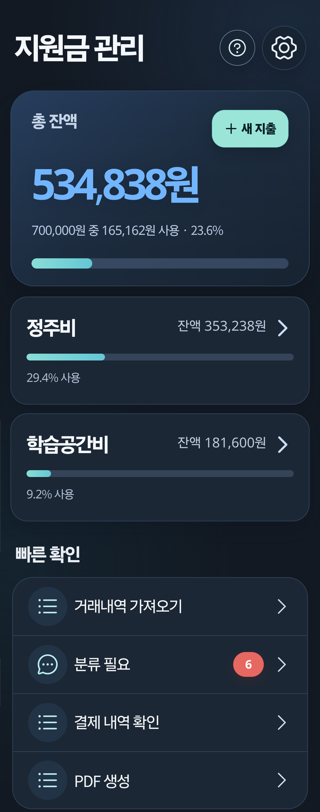
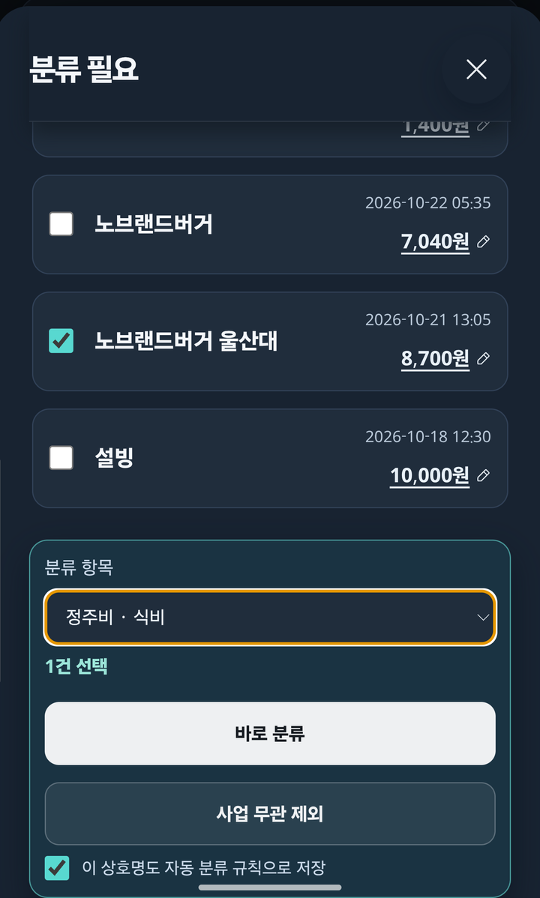
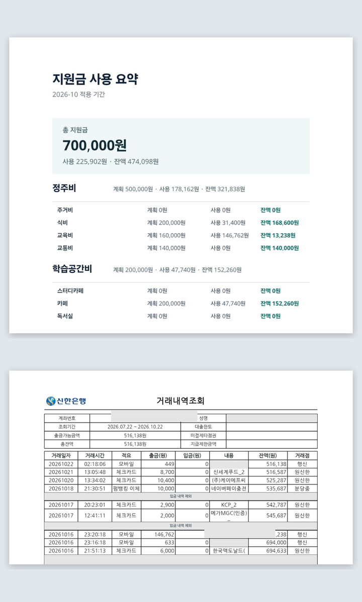
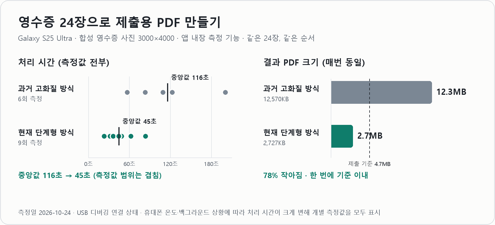

# 신청해 계산기

**지원금 예산 관리와 증빙 서류 준비를 기기 안에서 끝내는 Android 앱**

결제 알림을 읽어 항목별 예산에 반영하고, 제출용 증빙 PDF를 한 번에 만듭니다. 서버 없이 기기 안에서만 동작하며 Google Play 비공개 테스트로 배포 중입니다.

<table>
  <tr>
    <td align="center" valign="top" width="33%"><br><sub>예산 현황 한눈에</sub></td>
    <td align="center" valign="top" width="33%"><br><sub>애매한 결제는 사용자가 분류</sub></td>
    <td align="center" valign="top" width="33%"><br><sub>제출 PDF 자동 생성</sub></td>
  </tr>
</table>

> 개인 프로젝트입니다. 정부기관·신한금융희망재단·신청해 운영 사무국의 공식 앱이 아닙니다. 화면 이미지는 실제 사용 데이터에서 계좌번호·실명 등 식별 정보를 가린 것입니다.

## 1. 개발 배경

[신청해](https://shinchunghae.co.kr/)는 [신한금융희망재단](https://www.shinhanfoundation.or.kr/project/financial/07)의 청년 지원 사업입니다. 참여자는 매달 정해진 기간(기본 15일~다음 달 10일) 동안 정주비(주거·식비·교육비·교통비)와 학습공간비(스터디카페·카페·독서실)를 계획대로 쓰고, 기간이 끝나면 입출금내역과 영수증을 모아 제출합니다.

직접 참여하면서 세 가지가 번거로웠습니다.

- 결제할 때마다 어느 항목인지 분류하고 남은 예산을 따로 계산해야 한다.
- 항목 예산을 넘기기 전에 미리 알기 어렵다.
- 제출할 때 입출금내역의 개인정보를 가리고 영수증을 모아 용량 기준(5MB) 안에 맞춰야 한다.

## 2. 핵심 기능

| 기능 | 설명 |
| --- | --- |
| 결제 자동 반영 | 카드 결제 알림을 알림 접근으로 읽어 금액·상호·시각을 기록합니다. SMS 권한은 쓰지 않습니다. |
| 규칙 분류 + 분류 필요 | 직접 만든 상호 규칙으로 자동 분류하고, 애매한 결제는 "분류 필요"로 남겨 여러 건을 한 번에 분류합니다. |
| 예산 경고 | 항목별 사용률이 정한 기준(예: 50%·80%)을 넘으면 알립니다. 앱이 꺼져 있어도 동작합니다. |
| 거래내역 가져오기 | 카드 CSV·Excel·PDF와 은행 입출금 PDF를 가져와 알림으로 들어온 결제와 중복을 합칩니다. |
| 증빙 PDF 생성 | 지원금 요약, 개인정보를 가린 입출금내역, 영수증을 하나의 PDF로 만듭니다. |

## 3. 해결한 문제: 제출 PDF 용량

영수증 사진을 글자를 읽을 수 있는 선까지 해상도와 압축 품질을 낮춰 먼저 만들고, 제출 기준(4.7MB)을 넘을 때만 최대 3단계까지 더 줄이도록 바꿨습니다.



- **결과 PDF 크기**: 영수증 24장 기준 12.6MB → 2.7MB(78% 감소). 매번 같은 결과이며 첫 단계에서 바로 기준 안에 들어옵니다.
- **처리 시간**: 중앙값 116초 → 45초. 기기 상태에 따라 회차마다 크게 달라져 개별 측정값을 모두 공개합니다.

측정 조건과 원자료는 [제출 PDF 생성 성능 측정](docs/15-pdf-benchmark.md)에 있습니다.

## 4. 기술 스택

| 영역 | 사용 기술 |
| --- | --- |
| 화면 | React, TypeScript, Vite |
| 앱 | Capacitor(Android), Kotlin·Java 네이티브 플러그인(알림 수신, 위젯, 파일 저장, OCR) |
| 저장 | 암호화 SQLite (Capacitor Community SQLite) |
| 문서 처리 | PDF.js, pdf-lib, SheetJS, ML Kit 텍스트 인식 |
| 품질 | Vitest, Testing Library, Android 단위 테스트, GitHub Actions CI |

**설계 원칙**

- **기기 안에서만 처리**: 서버가 없고, 결제 알림 원문은 저장하지 않습니다.
- **판단은 사용자가**: 확실하지 않은 결제는 자동으로 차감하지 않고 "분류 필요"로 남깁니다.
- **계산은 한 곳에서**: 분류와 집계는 TypeScript가 맡고, 앱이 꺼져 있을 때 경고를 내는 Kotlin은 같은 테스트 사례 파일로 결과가 같은지 검증합니다.

## 5. 실행 방법

**요구 사항**: Node.js 24 LTS, Android Studio와 Android SDK, JDK 17 이상(Android Studio JBR 사용 가능)

```powershell
# 웹 개발·테스트
Set-Location app
npm install
npm run test:run
npm run dev
```

```powershell
# Android 디버그 빌드
Set-Location app
npm run android:sync
Set-Location android
.\gradlew.bat :app:assembleDebug
```

생성된 APK는 `app/android/app/build/outputs/apk/debug/app-debug.apk`에 있습니다. 릴리스 AAB는 `app/build-play-release.ps1`로 만들며, 서명키 경로와 비밀번호는 저장소에 기록하지 않고 실행할 때만 입력합니다.

## 더 보기

- [문서 목차](docs/README.md): 결정 기록, 설계, 검증, Play 제출 문서
- [제출 PDF 생성 성능 측정](docs/15-pdf-benchmark.md)
- [실기기 검증 체크리스트](docs/10-device-verification-checklist.md)
