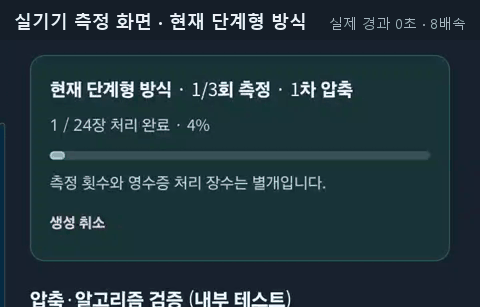
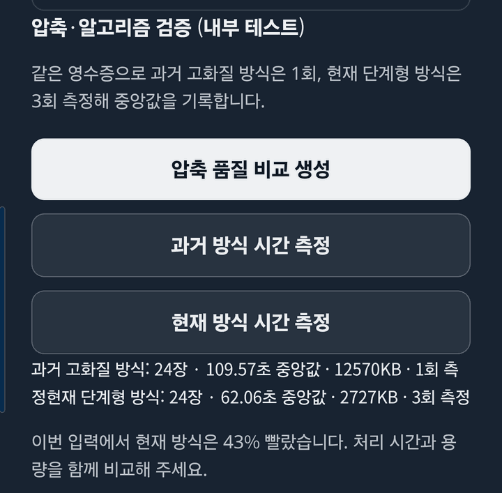

# 제출 PDF 생성 성능 측정 (2026-10-24)

영수증 사진을 제출용 PDF로 만들 때 쓰는 압축 방식을 바꾼 효과를 실기기에서 측정한 기록이다. README의 성능 근거 그림은 이 문서의 원자료로 만들었다.

## 무엇을 비교했나

| 방식 | 압축 방법 |
| --- | --- |
| 과거 고화질 방식 | 모든 영수증을 긴 변 1800px, JPEG 품질 0.82로 한 번에 넣는다 |
| 현재 단계형 방식 | 긴 변 1024px·품질 0.58로 먼저 만들고, 결과가 제출 기준(4.7MB)을 넘을 때만 920px·0.50, 800px·0.42 순서로 다시 만든다 |

두 방식 모두 앱에 들어 있는 같은 측정 기능(`app/src/features/evidence/benchmark.ts`, 내부 테스트 빌드에서만 보임)으로 쟀다.

## 측정 조건

- 기기: Galaxy S25 Ultra(SM-S938N), 검증 앱(`io.github.cjsan30.shinhanhae.calculator.verify`, 1.3.8 내부 테스트 빌드)
- 입력: 합성 영수증 사진 24장(3000×4000 JPEG, 평균 1.9MB). 실제 결제·개인정보는 없다. 같은 24장을 같은 순서로 썼다.
- 상태: PC와 USB 디버깅으로 연결(저속 충전), 화면 켜짐
- 통제 측정은 회차마다 AP 온도가 36°C 이하로 내려간 뒤 시작했고, 현재 → 과거 → 현재 → 과거 순서로 번갈아 돌렸다.

## 결과

### 결과 PDF 크기: 매번 같다

| 방식 | 크기 | 제출 기준 4.7MB |
| --- | --- | --- |
| 과거 고화질 방식 | 12,570KB | 넘는다 |
| 현재 단계형 방식 | 2,727KB | 첫 단계에서 들어온다 |

6번 측정 모두 같은 값이었다. 크기는 78% 줄었다.

### 처리 시간: 크게 흔들린다

| 회차 | 과거 고화질 방식 | 현재 단계형 방식(1·2·3번째) |
| --- | --- | --- |
| 1 | 57.08초 | 중앙값 44.75초(회차별 기록 없음) |
| 2 | 122.47초 | 61.99 / 23.25 / 36.25초 |
| 3 | 122.72초 | — |
| 4 | 200.71초 | — |
| 5(통제) | 83.47초 | 48.81 / 31.94 / 36.25초 |
| 6(통제) | 109.47초 | 83.75 / 44.76 / 62.24초 |

- 과거 방식 6회: 57~201초, 중앙값 약 116초
- 현재 방식 9회(회차별 기록이 있는 것): 23~84초, 중앙값 약 45초

현재 방식이 대체로 2배 이상 빠르지만 두 범위가 겹친다. 같은 입력·같은 온도에서도 회차마다 크게 달라졌고, 특히 현재 방식은 각 측정의 첫 번째 회차가 가장 느렸다. 그래서 "몇 % 빨라졌다"는 한 숫자 대신 측정값을 모두 공개한다.

## 해석할 때 주의할 점

- 앱 측정 화면의 비교 문구("이번 입력에서 현재 방식은 N% 빨랐습니다")는 과거 방식 1회와 현재 방식 3회 중앙값을 비교한다. 측정 횟수가 달라 공정한 비교가 아니므로 이 문서와 README에서는 쓰지 않는다.
- 과거 방식 측정은 한 번 만들고 끝난다. 실제로 과거 방식으로 만든 12.5MB 파일은 제출 기준을 넘어 다시 줄이는 과정이 필요했을 것이므로, 실제 사용 시간 차이는 이보다 클 수 있다. 이 부분은 측정하지 않았다.
- 휴대폰 온도, 백그라운드 작업, CPU 코어 배정에 따라 시간이 달라진다. 다른 기기에서는 결과가 다를 수 있다.

## 다시 재는 방법

1. `app/`에서 `npm run android:sync:internal` 후, 검증 앱 init script로 `assembleDebug`해 검증 앱에 설치한다([current_state.md](current_state.md) "검증 앱 빌드").
2. 합성 영수증 사진 20장 이상을 기기에 넣는다(실제 영수증·결제 정보는 쓰지 않는다).
3. 검증 앱 → PDF 생성 → 영수증으로 추가한 뒤, "압축·알고리즘 검증 (내부 테스트)"의 **과거 방식 시간 측정**과 **현재 방식 시간 측정**을 번갈아 누른다. 회차 사이에는 기기를 식힌다.

